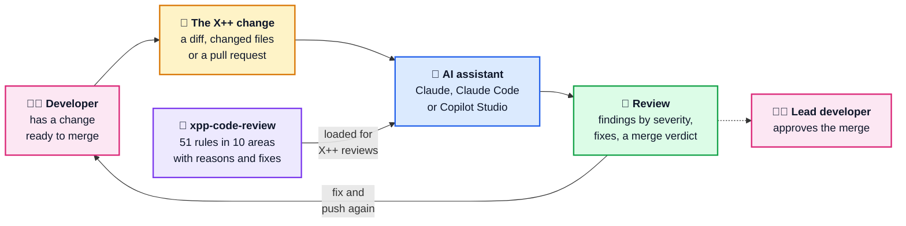
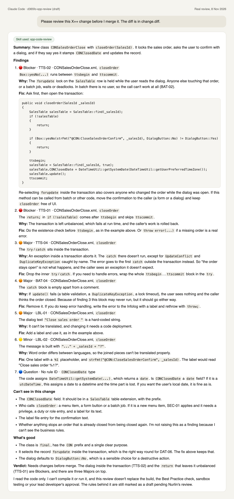

# D365 F&O X++ code review

[](https://github.com/DynAax-AB/dynaax-d365fo-xpp-review/actions/workflows/check.yml)


[](docs/install.md)
[](LICENSE)

A free AI skill that reviews X++ changes for Dynamics 365 Finance and Supply
Chain Management (F&O) the way a senior F&O developer would. Paste a diff or
point it at a pull request. For each problem you get the rule it breaks, why
it matters, the fix and how serious it is, then a verdict on whether to
merge.

> **Status: draft.** The rules are waiting for review by an experienced F&O
> technical lead before the first release. Use the reviews as a second pair
> of eyes, not a sign-off.

## What problem this solves

X++ pull requests are often reviewed in a hurry, or by someone who doesn't
know F&O well. The same problems reach production again and again: a Chain
of Command wrapper that skips `next`, a dialog inside a transaction, a loop
that updates 50,000 rows one at a time, a new menu item that only admins can
open.

The best practices are spread across Microsoft Learn pages, blog posts and
people's heads. This repo puts them in one list of **51 review rules** in
10 areas, each with a reason and a fix, and teaches an AI assistant to apply
them to a change.

It only reads code. It needs **no Windows dev VM**, no compile and no
connection to any F&O environment.

## How it works



The skill is instructions and reference notes for the AI assistant. It never
connects to F&O or your source control by itself. In Claude Code, the
assistant can read a pull request with `git` or `gh` if you ask it to.

## What it checks

| Area | Rules | For example |
|---|---|---|
| Extensions, not overlayering | EXT-01 to EXT-05 | No changes to Microsoft models, prefixes on added fields |
| Chain of Command | COC-01 to COC-07 | Always call `next`, `final` `_Extension` classes, no default values in wrappers |
| Event handlers | EVT-01 to EVT-04 | Validation results through the event args, delegates over wrappers |
| Data access and performance | DAT-01 to DAT-09 | Set-based updates instead of loops, no select inside a loop, `forupdate` in the right transaction |
| Transactions | TTS-01 to TTS-05 | Balanced `ttsbegin`/`ttscommit`, no dialogs inside, retry only at level 0 |
| Labels and hard-coded values | LBL-01 to LBL-04 | Labels for all text, no hard-coded companies, no secrets |
| Security | SEC-01 to SEC-04 | A privilege for every new menu item, lowest access level |
| Forms and display methods | UI-01 to UI-04 | Cached display methods, no queries per grid row |
| Batch and error handling | BAT-01 to BAT-05 | SysOperation, retryable batch jobs, no empty `catch` |
| Naming and Best Practice | BP-01 to BP-04 | Prefixes, no `breakpoint`, compile-time names |

Every finding gets a severity: 🔴 Blocker, 🟠 Major, 🟡 Minor or 🔵 Question.
The verdict is **Ready to merge**, **Merge after small fixes** or **Needs
changes before merge**. The full rules are in
[references/rules.md](skills/xpp-code-review/references/rules.md).

## Example

A real review from Claude Code with the draft skill installed, of
[samples/bad-dialog-in-transaction.diff](samples/bad-dialog-in-transaction.diff):



## Try it on the samples

[samples/](samples/) has eight small made-up diffs: five with problems and
three that are fine. [expected-findings.md](samples/expected-findings.md)
lists what a good review must find in each. Give the assistant one and
compare.

## Install

**Claude (web or desktop app):** download `xpp-code-review.zip` from
Releases, then Settings > Capabilities > Skills > Upload skill.

**Claude Code:**

```text
/plugin marketplace add DynAax-AB/dynaax-d365fo-xpp-review
/plugin install d365fo-xpp-review@d365fo-xpp-review
```

Then, in a repository: *"Review the changes on this branch against main."*

**Copilot Studio:** add the skill files to an agent as knowledge, and paste
the instructions from the install guide.

Full steps: [docs/install.md](docs/install.md). How to get a diff from Git,
Azure DevOps or GitHub: [docs/getting-a-diff.md](docs/getting-a-diff.md).

## Accuracy

- The rules are written from scratch and link to
  [Microsoft Learn](https://learn.microsoft.com/en-us/dynamics365/fin-ops-core/dev-itpro/)
  for the official documentation. Rules still to be confirmed are marked
  `REVIEW` in the files.
- The skill tells the assistant to say what it can't see in the change
  instead of guessing, and never to claim the code compiles or is safe.
- A review doesn't replace the build, the Best Practice check, tests or
  your lead developer's approval.
- This is a community project. It isn't affiliated with or endorsed by
  Microsoft.

Missed a problem, or flagged something that's fine? Please
[open an issue](CONTRIBUTING.md#ways-to-help).

## Contributing

New rules and fixes are welcome. See [CONTRIBUTING.md](CONTRIBUTING.md) for
the rule format and the checks to run.

## Licence

[MIT](LICENSE). Free to use, change and share.
